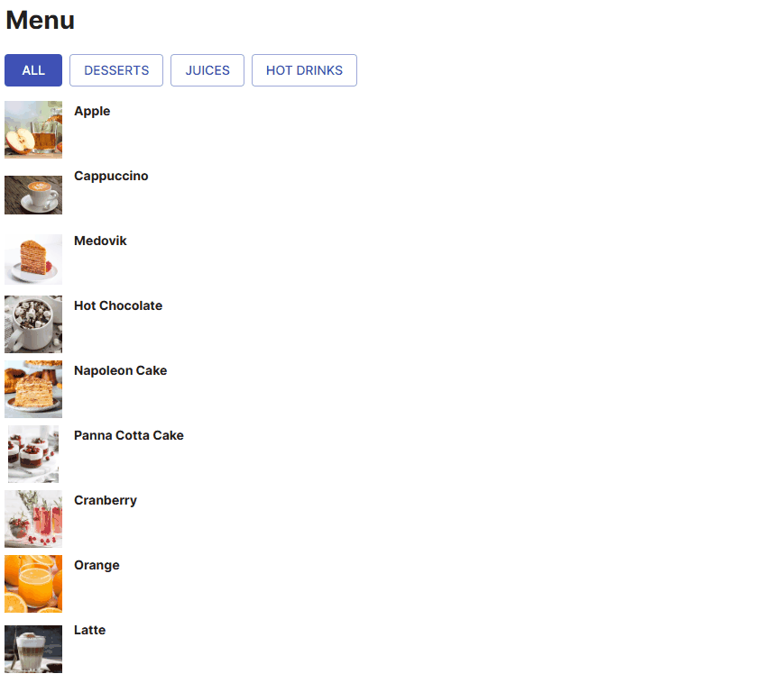
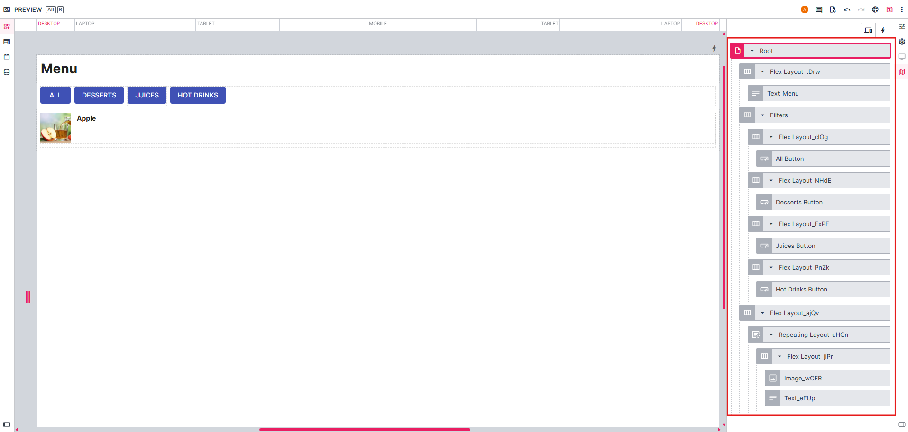
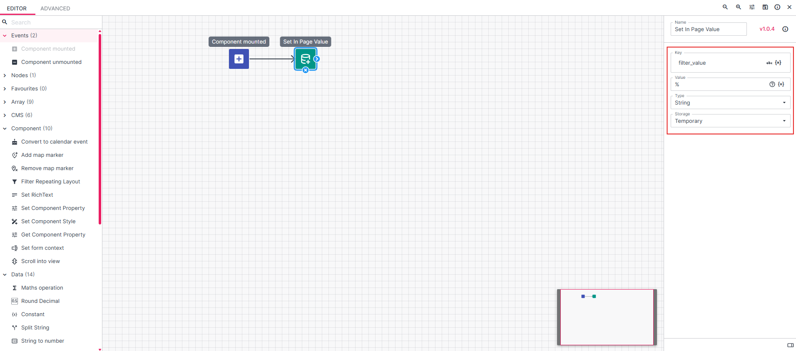
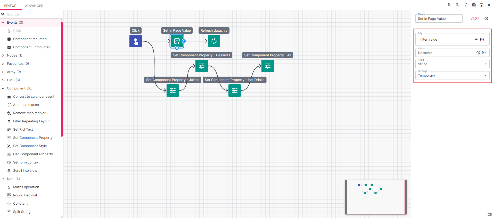
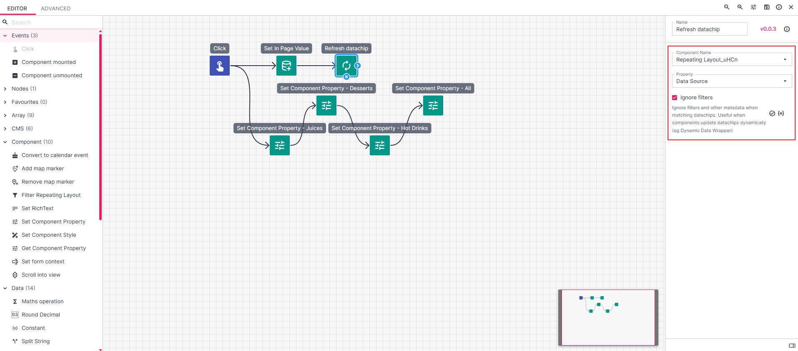
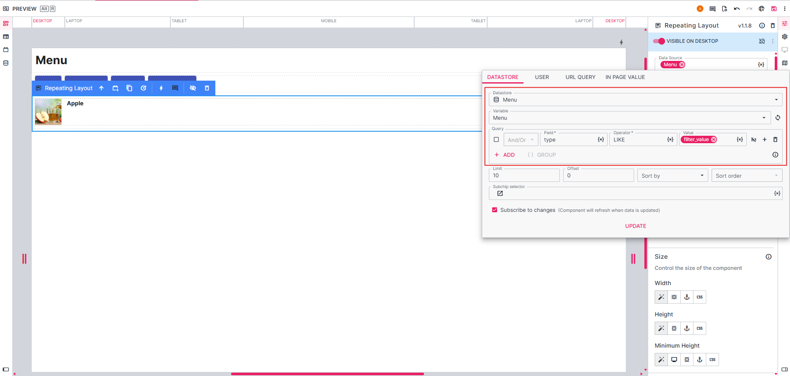
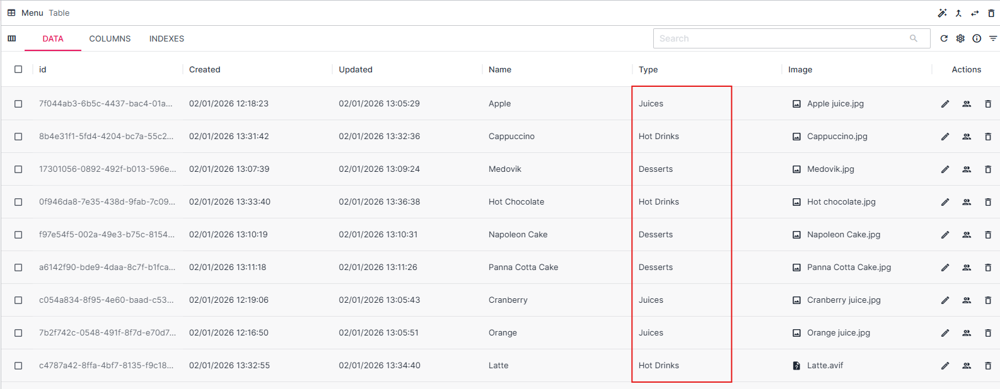
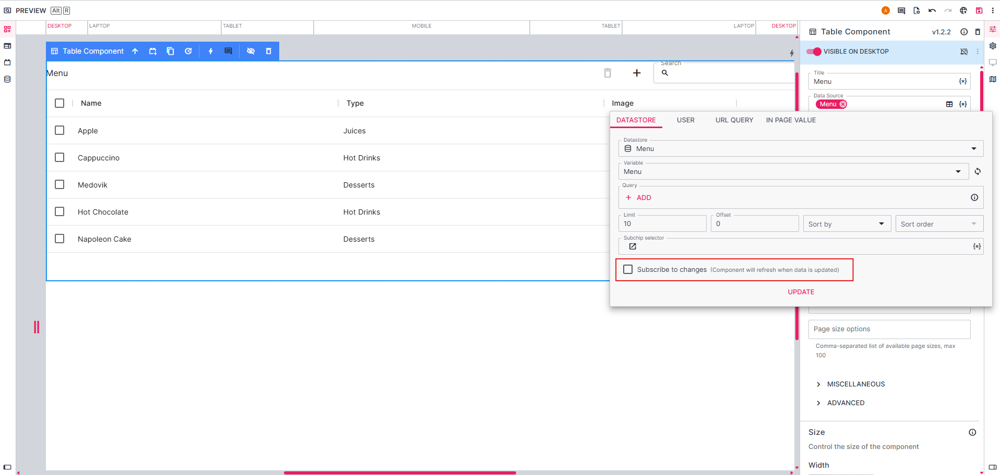
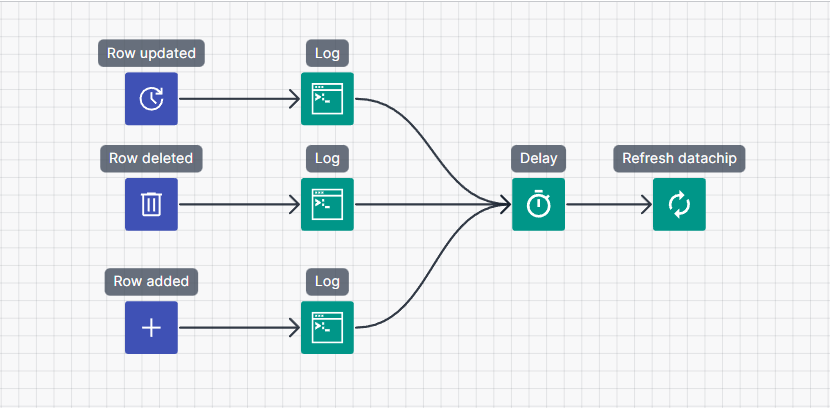
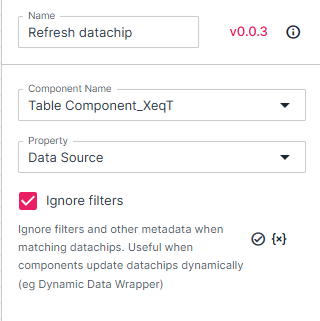

### Refresh Datachip: When to Use the In-Page Logic (IPL) Action

The **Refresh datachip** IPL action is typically used in the following cases:

- When we want to re-evaluate data based on a user action
- When we are working with a large table that is constantly updated, and we don’t want it to refresh every second. Instead, we configure it to refresh only after a specific action.

Below are examples of how these configurations can be applied.

_______________________________________

**Example: Using the Refresh datachip action to re-evaluate data based on a user action**

This example shows a simple menu with filter options. The user can choose between **All, Desserts, Juices, and Hot Drinks**. Using **Refresh datachip** action is one of the ways how filtering menu results can be configured. 

#### Page structure 

The Menu page consists of the following components:
- **Flex layout** with icon buttons that act as filters
- **Repeating layout** that updates its content based on the selected filter button, using the Refresh datachip action

#### How filtering is configured

Let's take a look at how the filtering is configured in the background.

1. **In-Page Logic** is created for the Flex layout that contains the Icon buttons: **Component mounted > Set In Page Value**. This action initializes the value that will be used for filtering.

2. For each filter button (All, Desserts, Juices, Hot Drinks), separate **In-Page Logic** is configured.

- Each button sets a specific **filter_value**
- The Refresh datachip action is triggered after the value is set

3. The Refresh datachip action refreshes the data in the Repeating layout based on the current filter_value.

The Repeating layout itself is configured as follows:

- Data source: Menu table (Table Columns: Name, Type, Image)
- Query: Type LIKE filter_value

With this setup, the Repeating layout query is updated every time the user clicks a filter button (for example, Juices). The menu items shown on the page immediately change to match the selected filter.
_________________________________

**Example: Using the Refresh datachip action with a Table data**

In the App Designer, start by adding and configuring a **Table component**. Select a table as the data source, and enable the **Editable**, **Deletable**, and **Can add rows** toggles.

If the table contains a large amount of data (for example, thousands of rows) and is updated frequently, you may not want it to refresh every second - pulling in thousands of rows repeatedly can be inefficient. In this case, you can **disable the “Subscribe to changes” toggle** and configure the table to refresh only in specific situations. For example, when the row is added, deleted or updated:

---

**Another example (advanced):**

You may also want to use a **Refresh datachip** for refreshing the values of not just a data source of a Table component or Repeating layout, but any component with a **Data Source** field (or equivalent). This may be because the subscribe to changes toggle has been disabled (as mentioned earlier), or because you have a query that is relying on an IPV that has updated after the data source was originally pulled.

For example:
- **Dynamic Data Wrapper** ("Data Source" field),
- **Select Field** ('List Data' field),
- **Info Chip** (When "Dynamic" is enabled, there is a "Category and colour table" data source),
- **Progress** (When "Determinate" is enabled, a user may have a datachip with a query pointing at a specific table row value for a progress number, based on a data source query in the "Progress" field),
- Any of the **chart components** (Material charts have a "Data" field, and Apex charts have a "Data Source" field).

