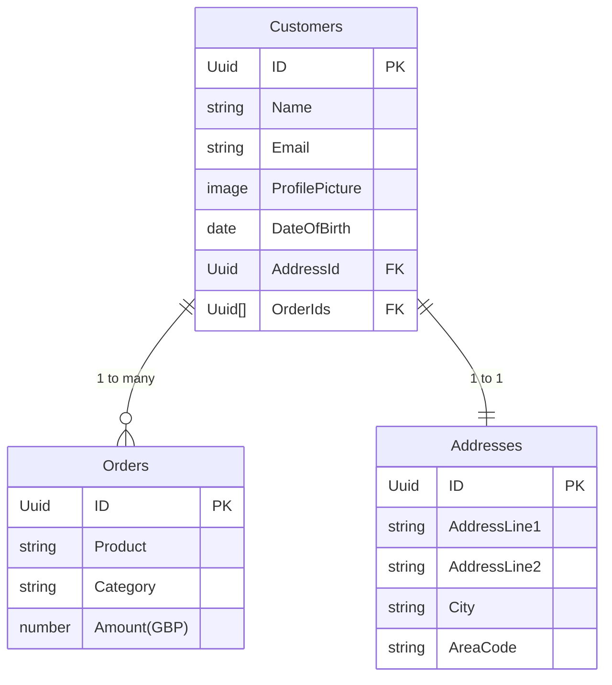

# Using Linked Data

So far in this chapter, we've looked at how you can create, link and query data, now let's take a look at where we can use this related data. Before we dive into how and where we can use it, let's first come up with an example scenario with some linked data.

## Building the Example

Let's imagine we have a table of Customers, a table of Orders and finally a table of Addresses. If you've followed along with the previous articles in this chapter such as :docs-link[Linking Data]{id="book/linking_data"}, then you'll have already built this example.

### Creating the Data

We start with our table of customers:

| Id  | Name            | Email address        | Profile picture | Date of birth |
| :-- | :-------------- | :------------------- | :-------------- | :------------ |
| 1   | Alan Turing     | alan@computers.inc   | 💻              | `1912-06-12`  |
| 2   | Tim Berners-Lee | tim@worldwideweb.com | 🌐              | `1955-06-08`  |
| 3   | Linus Torvalds  | linus@linux.net      | 🐧              | `1969-12-28`  |

Next, we create our table of addresses:

| Id | Address Line 1 | Address Line 2 | City | Area Code |
| :-- | :-- | :-- | :-- | :-- |
| 50 | Bletchley Park | Milton Keynes | Buckinghamshire |  MK3 6EB |
| 42 | CERN 1211 | Esplanade des Particules 1 | Geneva | 1217 |
| 64 | University of Helsinki | Yliopistonkatu 4 | Helsinki | 00100 |

Last, we have our table of Orders:

| Id |  Product | Category | Amount (GBP) |
|:-- | :-- | :-- | :-- |
| 987 | Engima Cracking Kit | Electronics | 99.99 |
| 988 | Turing Machine Parts | Electronics | 25.50 |
| 546 | Guide to the Internet | Books | 74.99 |
| 547 | How to build your first website | Books | 24.99 |
| 548 | Server for website | Computing Hardware | 24.99 |
| 321 | Guide to Microsoft Windows | Books | 0.99 |
| 322 | Guide to MacOS | Books | 1.99 | 3 |
| 322 | How to build an Operating System | Books | 5.99 |

### Linking the Data

Now, currently these tables are not linked, so to make this a varied example, we'll link the data as follows:

## Apps

### Dynamic Pages

### Repeating Layouts

## Automation

### Querying

### Subchips
