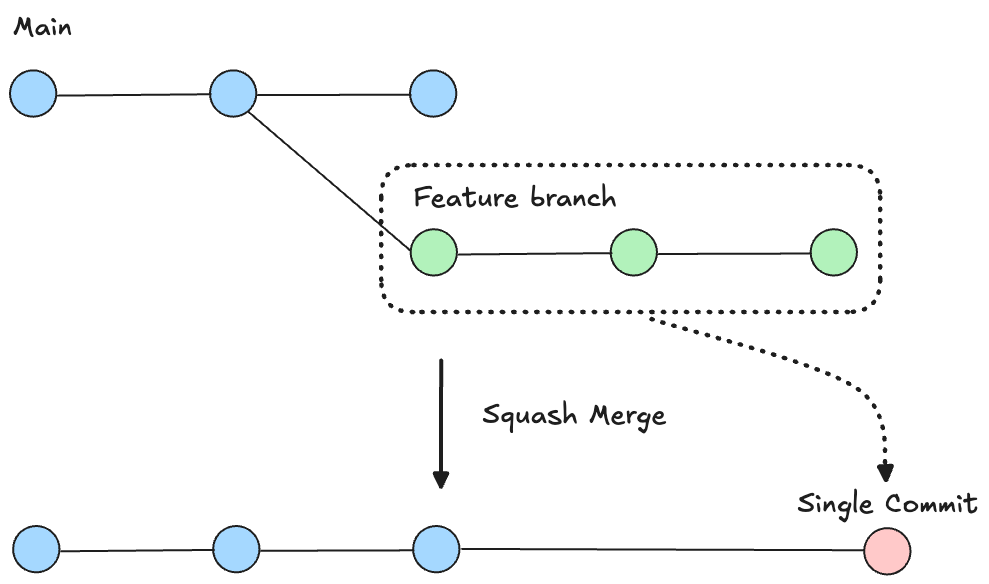
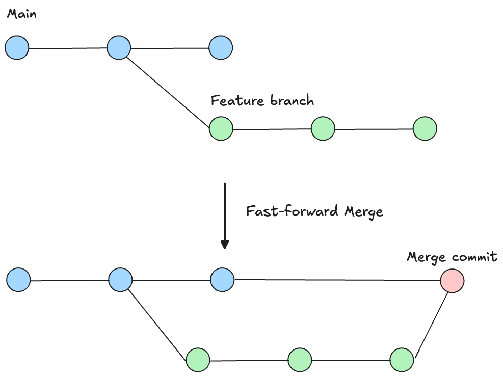
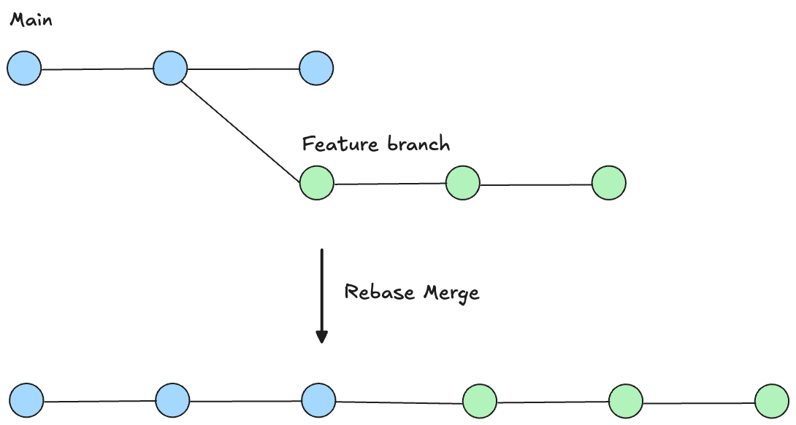

# Branch merging

Working with versioning typically means creating a feature branch to make changes on, then merging that branch into a target branch when complete, this allows you to make significant changes without affecting the original branch, allowing you to preserve a known good working configuration and only update it once you are confident that your changes are ready.

## Starting a merge

To merge a branch:

1. Open the **VCS Panel** in the workspace toolbar.
2. Open the menu options and select **Merge Branch**.
3. Choose your source branch and confirm the target branch.
4. Select your **Merge Strategy** and confirm the merge.

## Basic vs Advanced

### Basic mode

Basic will present you with the simplified choice of either keeping or discarding your source branch.

- Keep source branch - is most commonly used if you are running parallel branches (typically a `main` and a `dev`), and you want to update your stable branch with the new commits, and then continue working. Selecting this option will use a `Fast-forward` merge strategy and preserve individual commits which were made.

- Delete source branch - is best practice for feature work or bug fixes, where the work is considered complete and you are unlikely to continue working on the branch. Selecting delete branch will use a `Squash` merge strategy, transforming all the new commits from your branch and turning them into one consolidated commit on the target.

### Advanced mode

Advanced will present you with more granular options for your merge, allowing you to separately select a merge strategy (below) and whether you want to delete the source branch.

## Merge Strategies

Toca provides three merge strategies depending on how you want your commit history structured.

**1. Squash Merge _(Recommended for merging into `main`)_**

A squash merge takes all the individual commits on your source branch and condense them into a single, cohesive commit on the target branch. There is an option to delete your source branch after completing a squash merge, this is recommended to keep your workspace tidy.

- **Why use it:** Feature branches often contain messy interim commits (e.g. _"Fix typo", "Adjust navbar margin", "Test connector response"_). Squashing bundles all of these into one clean record, such as _"Address user feedback"_.
- **Best for:** Merging completed feature branches or bug fixes into `main` to keep your production commit history tidy and easy to audit.

**2. Fast-Forward**

A fast-forward merge moved the target branch pointer directly forward to match the source branch, preserving every individual commit in chronological order without creating a separate merge commit.

- **Why use it:** It maintains the full, granular step-by-step history of how the work was developed.
- **Best for:** Merging feature branches into one another when multiple developers are collaborating on the same large initiative and need full visibility into every intermediate change.

**3. Rebase _(Advanced - `main` only)_**

Rebasing takes the commits from your branch and replays them one-by-one directly on top of the latest commit on the target branch. In Toca, rebasing is an advanced workflow restricted strictly to merging into `main`.

- **Why use it:** It creates a perfectly straight, linear project history without merge commit bubbles, making it straightforward to trace history or bisect regressions
- **When to be careful:** Because commits are rewritten and re-applied sequentially, conflicts must be resolved commit-by-commit rather than all at once.

## See also

- :docs-link[Branches]{id="workspaces/branches"}
